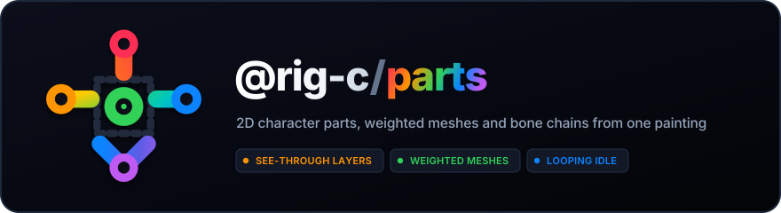

<p align="center">
  
</p>

<p align="center">
  <a href="https://www.npmjs.com/package/@rig-c/parts"></a>
  <a href="https://www.npmjs.com/package/@rig-c/parts"></a>
  <a href="LICENSE"></a>
</p>

# @rig-c/parts

**AI-authored 2D character rigs from one anime painting, verified before they
are written.** rig-parts generates no images. The painting and See-through layers
come from models the user runs on their GPU or a web demo; this package ships no
weights. The optional `comfy` adapter drives the user's own ComfyUI host and models.
rig-parts takes a single character painting and the layers
[See-through](https://github.com/shitagaki-lab/see-through) decomposed it into,
merges them into measured rig-space parts, authors weighted meshes, bone chains
and a looping idle over them in [rig-c](https://github.com/rig-c/core)'s
spec, and hands that spec to rig-c to compile, gate, pack, render and check.
It is built for agents that cannot see the image: every stage prints named,
numeric findings, a refusal names the object, the value found and the value
required, nothing is written after a red, and no value is invented where the
input is silent.

## What you get

<p align="center">
  
  
</p>

<p align="center">
  
</p>

<p align="center"><em>
A painting generated for this repository, split by See-through twice (the whole figure and
a square head crop), then built by one command: <code>rig-parts build --loop --lead-in 3</code>.
The proposer's bones, meshes, regions and motion were used as proposed but for one
correction. The generation record, the correction, the lines <code>check</code> printed and the
loop's encoding figures are in <a href="examples/demo/README.md">examples/demo</a>; the layers
and licence are in <a href="https://github.com/rig-c/examples">rig-c/examples</a>.
</em></p>

<p align="center"><em>
The hanging element, <code>examples/scarf</code>: Pony Diffusion V6 XL, no LoRA, a very long
red scarf whose ends hang free, and the first character run through this pipeline
with its proposal used unedited — the only hand corrections are four
<code>assemble.patches</code>, each answering an <code>uncovered hole</code> line.
<code>check</code> passes 9 of 9 with every mesh on the lattice and with every mesh
switched to the contour mode. It has no reference output: its <code>expected/</code>
is this port's own build (<a href="examples/scarf/README.md">examples/scarf</a>).
</em></p>

<p align="center"><em>
Two more characters are tracked as fixtures and not shown:
<code>examples/reference-demo</code> and <code>examples/reference-sample</code>, the two
the reference implementation ran (published as <code>demo</code> and <code>sample</code>
until issue #227, which took the clasped-hands painting off display). Their
<code>expected/</code> is that implementation's own output, which the selftest holds
this port to.
</em></p>

One rig can also carry **alternate drawings** as named sets — an outfit swap, or
mouth shapes (visemes) for speech — cut from extra paintings you supply, and the
player switches a set by name: see `assemble.alternates` in
[AUTHORING §3](docs/AUTHORING.md#3-configjson-field-by-field).

## What it takes in

- **One painting** — a PNG of one character that a rig can be cut from: front view,
  arms clear of the body, hands apart and open, legs apart with a gap, on a plain
  light background. [docs/PAINTING.md](docs/PAINTING.md) says what each requirement
  is for and what breaks without it, gives one generation recipe, and describes
  `rig-parts painting`, which checks a painting against its body-18 joints before
  See-through runs. To set up the machine that makes the painting and the layers,
  see [rig-c/getting-started](https://github.com/rig-c/getting-started).
- **Its See-through layers, twice**: one run on the whole figure (the painting padded
  white to a square) and one on a square crop around the head, because the eyes of a
  full-figure run are too small to separate. Either form See-through reaches you in
  is read:
  - the **ComfyUI wrapper form** — a directory holding `layers.json` and one RGBA PNG
    per layer (flat beside the manifest, or under `parts/<tag>.png`);
  - an **upstream `.psd`** — one pixel layer per tag, the layer name being the tag,
    the stacking order being the draw order.
- **A character config** (`config.json`) — the part plan, the head box, the bones,
  which bones may pull which layer, the idle's sines, and optionally `constraints`
  in rig-c's own rig-spec shape (ik, transform, path, physics, slider), handed
  to rigc as written once every bone they name resolves; a scene target is a bone
  under `root` a constraint names. `src/config.ts` is its
  schema and documents every field; the loader refuses an unknown or a missing field
  by name, and reads nothing under `note`, a `<name>_note` (a string) or a key
  beginning `x-` (any JSON — a project's own records, such as a past build's gate
  results). [docs/AUTHORING.md](docs/AUTHORING.md) says where each value comes from.

## What it gives out

`rig-parts build` ends the way a Spine editor export does — with **one packed atlas
page** (issue #2):

| path under `--out` | what |
| --- | --- |
| `check/build/skeleton.json`, `skeleton.atlas`, `skeleton.png` | **the artifact** — Spine 4.3 skeleton data and one packed page, written by `rigc build --pack --page-edges free --pack-shape polygon` and gated under `rig-play` (named `spine-html` before rig-c 2.50.0), which holds every rule `spine` measures (on reference-demo, rigc 2.1.3 and 2.10.1: the 14 rules `validate --profile spine` measures are among the build's 24; 16 are not in `spine`) |
| `parts/*.png`, `parts.json`, `recomposite_rig.png`, `recomposite_error_rig.png` | the loose parts, each cropped to its alpha box; the record of where every part came from, how many of its pixels were re-taken from the painting, and the recomposite's uncovered holes with their boxes; the flat stack of parts; its error map — red where no part covers a pixel the painting has, blue where a part covers it in the wrong colour |
| `rig/` | `rig.json` and `motion.json` in rig-c's spec, `mesh_report.json`, the padded `images/` |
| `check/` | both gate files verbatim, the idle's frames and their `geometry.json` (skinned vertices per frame), `contact.png`, `motion_heat.png`, `check.json` (with `pack_mode`, the `--page-edges` and `--pack-shape` the page was packed under) |
| `idle.png`, `idle-indexed.png`, `idle.gif` | with `--loop`: the idle as a lossless APNG (the exactness record), an indexed APNG with one shared palette (the small one) and a GIF; the last two print their palette error |

Beside the skeleton data rig-c writes `check/build/skeleton.model.json`, the compiled
model document. [@rig-c/play](https://github.com/rig-c/play) loads that file and
draws the rig in a browser, as plain DOM elements or on one canvas.

The last lines of a green build are the pack line, printed beside the Spine example
export's `spineboy.png` as a yardstick (a reference, not a bar), and the three
artifact paths — here for `examples/reference-sample`:

```
build: PASS — the packed atlas is the artifact; parts/ and rig/ are the intermediates it was made from
  pack: skeleton.png 477x1151, 20 region(s), 95.0% covered, padding 2, page edges free, shape polygon; page opaque 54.8% (alpha > 0) — spineboy yardstick 1024x256, 40 region(s), 45.8% opaque (alpha > 0), a reference and not a bar
  out/check/build/skeleton.json
  out/check/build/skeleton.atlas
  out/check/build/skeleton.png
```

The page's edges are free by default: rigc picks the least-area page the parts need, not
the next power of two; `--page-edges pot` is for a consumer that mipmaps or repeats the
page. The pack shape is `polygon` by default: a region only meshes draw is packed by its
emitted hull; `--pack-shape rect` packs every region by its rectangle. What each costs and
saves, measured on the reference examples, is in
[AUTHORING §5, *Page edges*](docs/AUTHORING.md#5-after-each-stage-what-to-read) and *Pack shape*.

The packer is rig-c's, and no other: a packed region is a lossless copy, and an
atlas written by anything else would have no oracle behind it.

## Painting → parts → rig → browser

| stage | tool | what it owns |
| --- | --- | --- |
| painting + See-through layers → parts and specs | **rig-parts** (npm `@rig-c/parts`) | the merge of two runs, the measurements, the rig spec and motion spec |
| specs → Spine skeleton data | **[@rig-c/core](https://github.com/rig-c/core)** (npm dependency `@rig-c/core`) | compile, the gate (rigc's own validator in an install; the round trip through `spine-core` where the runtime is beside it, as in this repository's CI), the named assertions, the packer, the renderer |
| compiled model → a page | **[rig-play](https://github.com/rig-c/play)** (npm `@rig-c/play`; formerly spine-html), a sibling project | the browser player: it loads the compiled model document and draws it as DOM elements or on one canvas; rigc's `rig-play` profile is its policy, and every build here is gated under that profile as well as under `spine` |

rig-parts never writes Spine data itself. Everything on disk under `check/build/`
was written by rig-c after its own gate passed.

Next stops: [@rig-c/review](https://github.com/rig-c/review) is where a person looks at a build and answers, and [@rig-c/create](https://github.com/rig-c/create) drives the whole cycle with an agent.

## Getting See-through layers

See-through is required; how you run it is not. rig-parts does not vendor, embed or
redistribute See-through code or weights — run it by any of these and point
rig-parts at what it wrote:

| Route | Where | Output rig-parts reads |
| --- | --- | --- |
| Hugging Face Space | [24yearsold/see-through-demo](https://huggingface.co/spaces/24yearsold/see-through-demo) (ZeroGPU) | the `.psd` it produces; upload `st_input_full.png`, the white-padded square from `inputs`, for the full run, and `st_input_head.png` for the separate head run |
| ModelScope demo | [ljsabc/See-Through](https://modelscope.cn/studios/ljsabc/See-Through), linked from the upstream README | the `.psd` it produces |
| Upstream CLI | `python inference/scripts/inference_psd.py --srcp <image> --save_to_psd` in a checkout of [shitagaki-lab/see-through](https://github.com/shitagaki-lab/see-through) | the `.psd` in `workspace/layerdiff_output/` |
| ComfyUI wrapper | [jtydhr88/ComfyUI-See-through](https://github.com/jtydhr88/ComfyUI-See-through) on your own ComfyUI box; the optional `comfy` adapter (`rig-parts comfy seethrough`) drives it | the `layers.json` + PNGs it writes |

Use the square `inputs` outputs on the Space too: `st_input_full.png` supplies the white
padding rig-parts maps back to the original painting
([source reading](docs/AUTHORING.md#see-through-space-input-source-reading)).

The [head-run source reading](docs/AUTHORING.md#see-through-head-run-source-reading) explains why a separate head crop is needed.

**See-through is required; ComfyUI is not.** The wrapper is one route among
four, and `rig-parts comfy` is only a convenience for that route: every
stage after See-through reads files, whichever route wrote them.

### The two images See-through is fed: `inputs`

```sh
rig-parts inputs --source painting.png --config config.json --out <dir>
```

cuts the two images See-through is fed: the painting centred on a white square
(`st_input_full.png`) and, when the config sets `seethrough.head_box`, that
box at its exact size (`st_input_head.png`). Pure raster, no GPU.

### The optional ComfyUI adapter

For a user who has a ComfyUI box, two
commands make the painting and the layers on it; nothing else in the pipeline needs one:

```sh
rig-parts comfy paint --config config.json --out <dir> --host http://<box>:8188
rig-parts comfy seethrough --image st_input_full.png --out layers/full --host http://<box>:8188
```

`comfy paint` asks the user's models to generate `painting_<seed>.png` from the config's inline
`generation` block — checkpoint, LoRAs, sampler, and an optional OpenPose
control skeleton it draws itself — and records the prompts verbatim beside it.
`comfy seethrough` runs the [ComfyUI-See-through](https://github.com/jtydhr88/ComfyUI-See-through)
wrapper on one image and writes the wrapper form `layers` reads. The host comes
from `--host` or `COMFY_HOST` and has no default; before anything is uploaded
the graph is checked against the box's `/object_info`, so a missing node class
or model is refused by name, and the adapter appends the job behind any other in
the queue.

The painting graph uses `4x-AnimeSharp.pth`, then Lanczos resizing. The
[creator's card](https://huggingface.co/Kim2091/AnimeSharp/blob/7696d95ced82b0c1f2a41f6ac73336133f0a90e1/README.md)
declares CC BY-NC-SA 4.0. When `generation.control` is set, the intended OpenPose
ControlNet is [xinsir/controlnet-openpose-sdxl-1.0](https://huggingface.co/xinsir/controlnet-openpose-sdxl-1.0/blob/23f966cd5cfdd3f7729c903e243d87152162d2b7/README.md),
whose card declares Apache-2.0. Install its `diffusion_pytorch_model.safetensors`
on the host as `controlnet-openpose-sdxl-1.0.safetensors`, or select its installed
filename with `generation.control.model`. A filename alone does not verify the
weights. [NOTICE](NOTICE.md#models-named-by-the-optional-painting-graph) pins the
sources and records their declared terms; those declarations do not assign a
blanket licence to output images. The graph's automatic upscaler selection is
unchanged; the owner decision is tracked separately in [#428](https://github.com/rig-c/parts/issues/428).

`--offload` selects the wrapper's CUDA group-offload path on the **ComfyUI host**; omit it
for a local Mac/MPS host. The source reading behind it, and how the shipped graph differs
from the wrapper's README, are in
[AUTHORING, *The optional ComfyUI adapter*](docs/AUTHORING.md#source-readings-for-the-see-through-graph).

## The loop, for an agent

```sh
rig-parts inputs --source painting.png --config config.json --out inputs   # st_input_full.png; the config needs assemble.rig_scale
#    See-through on st_input_full.png (external, or `rig-parts comfy seethrough`) -> layers/full
rig-parts layers layers/full                      # drawn(a>8)/opaque(a>=250) boxes, CORE body-group height in input-canvas px, WARNs
rig-parts propose --head-box --full layers/full --canvas 1664x2432
#    -> seethrough.head_box into config.json
rig-parts inputs --source painting.png --config config.json --out inputs   # now st_input_head.png too
#    See-through on st_input_head.png (external, or `rig-parts comfy seethrough`) -> layers/head
rig-parts sheet --source painting.png --layers layers/full --layers layers/head --out sheets/layers.png
rig-parts assemble --propose-plan --source painting.png --full layers/full --head layers/head --config config.json
#    -> assemble.plan and extend_below_crop
rig-parts assemble --source painting.png --full layers/full --head layers/head --config config.json --out work
#    -> work/rig: parts.json and parts/; the config holds no bones, meshes, regions or motion yet
#    -> read the `uncovered hole N:` lines and look at work/render/recomposite_error_rig.png:
#       red is painting that no part holds, and no later gate can see it
#    -> a large red hole neither run holds? add an assemble.patches entry (cut from the painting) and assemble again
rig-parts propose --parts work/rig --bust-landmarks bust-landmarks.json --source painting.png --out work
#    -> proposal.json, basis.json (what each bone rests on) and render/landmarks.png; per-bone coverage lines;
#       correct it, copy bones/meshes/regions/limbs/motion/constraints/turn/motion_seams/proposed_rig_scale into config.json, each it wrote
#       (limbs only with --keypoints, constraints only with --cloth, turn only with --full/--head;
#       a limbs block left out is refused next)
rig-parts propose --parts work/rig --source painting.png --out work --from-config config.json
#    -> LINT lines; exit 1 while any remain (takes --parts, --source, --out, --from-config and optional --keypoints [--person] only;
#       proposes nothing, so --full, --head, --cloth, --write-config, --wrist-snap, --grid-rule, --only-missing and --compare are refused)
rig-parts build --config config.json --source painting.png --full layers/full --head layers/head --out out --loop
#    -> read out/check/check.json; every FAIL line names what has to change
```

At each step the config holds only what that step reads; the one table of what
that is, step by step, is [docs/AUTHORING.md §4](docs/AUTHORING.md#4-the-command-order).
How the selftest runs this block on each example is in
[CONTRIBUTING.md](CONTRIBUTING.md#the-readme-loop-as-the-selftest-runs-it).

`propose` is deliberately not a step of `build`: the proposal is a draft to correct
against its overlay, and a config with bones is `build`'s input. `rig`, `check` and
`loop` are the same stages one at a time. [docs/AUTHORING.md](docs/AUTHORING.md) is
the guide an agent authors from — every config field, what to look at after each
stage, what each refusal means and which field it points at — and
[`skills/rig-parts/SKILL.md`](skills/rig-parts/SKILL.md) is the same loop as an
agent skill.

## Commands

Command details and config saving are in the [command reference](docs/AUTHORING.md#command-reference) and [stable interface](docs/STABILITY.md#commands-and-flags).

| command | does |
| --- | --- |
| `inputs` | [Prepare the two See-through input images](docs/AUTHORING.md#command-reference) |
| `comfy` | [Drive optional ComfyUI jobs: painting, layers, matte and plate](docs/AUTHORING.md#command-reference) |
| `layers` | [Inspect wrapper layers or a PSD](docs/AUTHORING.md#command-reference) |
| `head-crop-preflight` | [Report what a head box would clip, before the head run](docs/AUTHORING.md#command-reference) |
| `sheet` | [Make a contact sheet](docs/AUTHORING.md#command-reference) |
| `assemble` | [Merge layers into measured parts](docs/AUTHORING.md#command-reference) |
| `check-parts` | [Check assembled parts' integrity and write a report](docs/AUTHORING.md#check-parts) |
| `diff-components` | [List every place the stacked parts differ from the painting](docs/AUTHORING.md#whole-figure-difference-inventory) |
| `diff-drafts` | [Compare two assemble outputs](docs/AUTHORING.md#command-reference) |
| `depth-prepare` | [Write one depth-model input image per part](docs/DEPTH.md#1-prepare-one-inference-image-per-part) |
| `depth-bind` | [Bind a depth map to its prepared input](docs/DEPTH.md#3-bind-every-map-to-its-prepared-input) |
| `depth-apply` | [Apply depth maps to the parts as depth sheets](docs/DEPTH.md#4-apply-the-maps-as-depth-sheets) |
| `edited-part` | [Record an edited part receipt](docs/AUTHORING.md#edited-rig-space-parts-assembleedited_parts-issue-1278) |
| `external-receipt` | [Record or verify an external mask](docs/AUTHORING.md#external-mask-receipt) |
| `propose` | [Draft or inspect a character config](docs/AUTHORING.md#command-reference) |
| `bust-landmarks` | [Write the chest landmarks file from a review act](docs/AUTHORING.md#drafting-the-chest-carrier) |
| `compare` | [Compare two skeletons by name](docs/AUTHORING.md#command-reference) |
| `rig` | [Author gated rig and motion specs](docs/AUTHORING.md#command-reference) |
| `check` | [Build, render and measure a rig](docs/AUTHORING.md#command-reference) |
| `loop` | [Encode rendered frames as GIF or APNG](docs/AUTHORING.md#command-reference) |
| `build` | [Assemble, rig and check in one process](docs/AUTHORING.md#command-reference) |
| `compose` | [Combine character builds into a scene](docs/AUTHORING.md#command-reference) |
| `mesh-draft` | [Draft and compare contour meshes](docs/AUTHORING.md#command-reference) |
| `mesh-stats` | [Count mesh vertices and triangles](docs/AUTHORING.md#command-reference) |
| `painting` | [Check a painting against declared joints](docs/AUTHORING.md#command-reference) |
| `remesh` | [Revise one mesh in a gated rig](docs/AUTHORING.md#command-reference) |
| `retune` | [Revise constraints and idle in a gated rig](docs/AUTHORING.md#command-reference) |
| `guide` | [Read the installed authoring reference](docs/AUTHORING.md#command-reference) |

## Depth-driven rigging

[docs/DEPTH.md](docs/DEPTH.md) is the feature page for a person: what a depth-driven turn gives you, the two stages that make the sheets, how to pick a painting and how to judge the result.
See the [depth-driven rigging reference](docs/AUTHORING.md#depth-driven-rigging) for sampled head and body turns and unit-depth precedence.

### Per-layer depth input

See the [per-layer depth input contract](docs/AUTHORING.md#per-layer-depth-input) for opt-in sheets, calibration and their consumers.

## What it does not do

These are limits of the approach, stated so nobody reads more into a green run:

- **rig-parts generates no images.** The painting and See-through layers are made
  by models the user runs on their GPU or a web demo. No weights ship here; the
  optional `comfy` adapter drives the user's own ComfyUI host and models.
- **Legacy turns use one ordering depth per layer.** See-through also supplies per-pixel
  sheets, consumed by the shipped 2.5D head-turn producer through [config.turn.roles](docs/AUTHORING.md#3-configjson-field-by-field). A layer that is in front of another in one place and behind it in another is drawn
  right in the still (the painting's own pixels are projected onto it) and wrong once
  it moves.
- **No expression axis, no lip-sync from audio, and no jiggle.** The base rig's mouth is
  one layer. Mouth shapes exist only as alternate sets you paint and declare
  (`assemble.alternates`, [AUTHORING §3](docs/AUTHORING.md#3-configjson-field-by-field)),
  switched by name or keyed by hand in a named animation; nothing here draws them or
  reads speech, and nothing here proposes, keys or judges a soft region. An expression
  that moves the face's parts, and a jiggle, can be built on the rig it writes
  ([below](#what-can-be-built-on-top)).
- **Occluded pixels are See-through's synthesis**, not the artist's. How much of a rig
  that is, is below.
- **No success rate is claimed.** Ten characters have been measured stage by stage
  against the reference implementation this package ports — the two public examples
  here and eight private ones, one See-through seed each — and all ten check green
  on the gates, the seam and the loop. The judgement lines `check` added since
  (issue #11) have been measured on the three public examples only (the third,
  `scarf`, was made after the port and has no reference output). That is an
  existence proof, not a rate.
- **`loop` writes GIF and APNG (lossless and indexed), not WebP**: an animated WebP needs a VP8/VP8L
  encoder, which this package does not carry.
- **The proposer reads the torso by screen y unless it is told the pose.** Its ratios
  put the hip below `bottomwear`'s top edge and the chest above it, and hang the sleeves
  from the shoulders. A figure whose joints are not there — reclining, an arm raised, or
  seated in a skirt that does not start at the hip — needs `propose --keypoints`; sitting
  alone does not, but a clean LINT does not show the hip is right (it asks only that the
  hip be below the chest and the shoulders), so read the overlay ([AUTHORING §3](docs/AUTHORING.md)). The
  file of joints comes from any pose
  estimator or a hand; this package does not estimate a pose itself, and its
  keypoint support has been measured on generated figures and on files read off the
  examples' own configs, and on one reported estimator output: RTMPose whole-body
  through rtmlib on one painting built green with the estimated file unedited
  ([#356](https://github.com/rig-c/parts/issues/356)). That is one measurement,
  not an estimator success rate; it has not been re-run here.
- **The proposer reads tags, not pictures.** A swinging element painted inside another
  layer (a sash tail in the skirt), hair that is none of the shapes it knows, and
  whether an accessory swings are the corrector's to add. The one accessory shape it
  measures is a hanging strand on a headwear or earwear layer: each gets a pendulum
  chain, and a strand it cannot chain is named in a note rather than left stiff.

### What can be built on top

This package makes no expression and no jiggle, but the rig it writes is the material for
both, and the config has a field for each; `examples/demo` and `examples/scarf` carry a worked
set of each (issue #224: a hop, a head tilt, a wave or a bow, and physics on the hair, the
skirt, the sleeves and the scarf ends; also two head turns, a smile and a startle, which at
full-body size read as small moves of the head and face rather than as expressions —
one image per slot leaves the face only what its bones can do). [docs/AUTHORING.md](docs/AUTHORING.md) has a recipe
for each — a config fragment, the `check` lines it passes with, and its limit:

- [**Expressions and other named animations**](docs/AUTHORING.md#recipe-expressions-and-other-named-animations):
  the face's parts are bones; animations written over them in rig-c's motion-spec shape and
  named by `motion.animations_from` are built and gated beside the idle on every build. Keys
  carry core motion fields, including raw `curve` control points in absolute time/value
  coordinates ([core key format](https://github.com/rig-c/core/blob/main/docs/AUTHORING.md#45-keys--times-values-curves));
  the linked recipe includes a core-gated example. Without
  an alternate set a slot holds one image, so a part moves, turns and scales but is not
  swapped for another; `check` measures the idle alone.
- [**A soft region driven by physics**](docs/AUTHORING.md#recipe-a-soft-region-driven-by-physics)
  (a bust, the hips): a bone the config authors, a contour-mode region that hands it the patch,
  and a `physics` constraint on it; `examples/reference-sample` carries one. The spring
  answers faster keys on the body more than a slow idle, the region's `band` caps how far a
  patch may go before the texture-stretch ceiling, and `check` measures the idle alone.

### How much of a rig the model painted

`parts.json` splits each part's opaque pixels into `visible_px` and `occluded_px`, and
counts the visible ones whose colour was not taken from the painting
(`visible_not_projected_px`). The occluded share is art the painting does not show — a
back-hair layer, a neck — and is See-through's synthesis by necessity. The figures for the
four examples, and what `--project visible` changes, are in
[AUTHORING §5](docs/AUTHORING.md#how-much-of-a-rig-the-model-painted).

## Requirements

[Bun](https://bun.sh) 1.4 or later. `npm i -D @rig-c/parts` installs the `rig-parts`
command (`npm install -g @rig-c/parts` puts it on `PATH`); it hands off to Bun and says
so in one sentence if Bun is not on `PATH`. `@rig-c/core` comes with it as a dependency,
providing the `rigc` command; no Spine runtime does. [docs/STABILITY.md](docs/STABILITY.md#rig-c)
says what this package relies on in rig-c and which validator gates an install, and
[RELEASING.md](RELEASING.md#three-names-one-tree) covers the package's earlier install names.

## Licence posture

MIT; see [NOTICE.md](NOTICE.md) for third-party terms and the Spine runtime licence posture.

## Development

`bun install`, then `bun run typecheck`, `bun run lint` and `bun run selftest`.
[CONTRIBUTING.md](CONTRIBUTING.md) has every command and what a change has to clear; [CLAUDE.md](CLAUDE.md) is the doctrine, [RELEASING.md](RELEASING.md) the cut, [docs/STABILITY.md](docs/STABILITY.md) the interface it holds.

## Licence

MIT — see [LICENSE](LICENSE). Third-party terms: [NOTICE.md](NOTICE.md).
