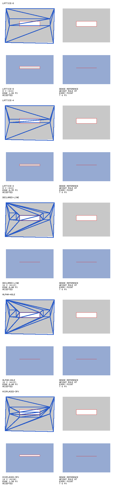

# Interior contours: current-toolchain refresh (#160)



**Reading: inconclusive; no source mechanism justified.** The declared rectangle and the independently traced alpha-hole edge produce byte-identical reduced meshes and near-zero opening-edge error. They require 16 final vertices, against 8 for either lattice control. The half-spacing lattice meets the 1 px bar at 0.95 px. The displaced-line plant is worse (1.5 px), but has 14 final vertices rather than 16, so the predeclared equal-budget plant bar is **not met**. These results support neither an economy claim nor a general impossibility claim about lattices.

This page refreshes [the original Stage A reading](auto-feature-contours.md), without rewriting its historical figures. Bars were posted [before measurement](https://github.com/rig-c/parts/issues/160#issuecomment-6394715413); the topology-only source selection was [specified before the run](https://github.com/rig-c/parts/issues/160#issuecomment-6394736374).

## Input and metric

The public input is the explicitly synthetic [blink fixture at 4bfd3c53cc49c92cc7928ea943b1a7ee72283808](https://github.com/rig-c/parts/blob/4bfd3c53cc49c92cc7928ea943b1a7ee72283808/tools/feature_contour_survey.ts#L635): a 56×40 opaque block in a 64×48 image, with a 24×6 alpha hole at (20,19). No natural public artwork is claimed to carry a declared closing motion. No private input or authored export was read; the older public-art census is not rerun here.

The lid translates (0,6). Its fixed weight rule is 1 at y≤19, 0 at y≥25, and (25−y)/6 between. Every variant uses this same mask, evaluation edge, weight rule and motion. The plant changes only the supplied rectangle to y=22..28. Alpha-hole extraction takes `fillHoles(art) − art`, with the existing 4-connected fill, traces the enclosed component and canonicalizes its start, orientation and collinear corners. That result is exactly the declared (20,19)..(44,25) rectangle.

The metric confirmed in `edgeDisplacement` is the maximum `abs(interpolatedWeight − rule(p)) × 6` at 240 samples, 0.25 px apart around the original opening. Pure translation makes the fully closed pose the maximum over the motion. No uncarried sample is counted as zero or allowed to pass. This is a sampled edge metric, not a proof of continuous coverage, an actual raster-gap measure, a texture-stretch check, or a compiled-rig motion comparison.

Source-vs-rule is reported separately from reduced-vs-rule. The reducer's residual and result-vs-source use art pixel centres and bound reduction error against its own source; a green residual alone does not show that the source carries the intended opening.

## The five builds

| build | source vertices | final vertices | triangles | source edge vs rule, px | final edge vs rule, px | carried / uncarried edge samples | result vs source, px | skinning residual / bound | pipeline verdict |
| --- | ---: | ---: | ---: | ---: | ---: | --- | ---: | --- | --- |
| lattice-8 | 47 | 8 | 10 | 1.875 | 1.875 | 240 / 0 | 0.9375 | 0.937498 / 1 (pass) | accepted |
| lattice-4 | 129 | 8 | 10 | 0.75 | 0.95 | 240 / 0 | 0.784576697402 | 0.784577 / 1 (pass) | accepted |
| declared-line | 57 | 16 | 26 | 6.66133814775e-16 | 6.66133814775e-16 | 240 / 0 | 0.9375 | 0.937498 / 1 (pass) | accepted |
| alpha-hole | 57 | 16 | 26 | 6.66133814775e-16 | 6.66133814775e-16 | 240 / 0 | 0.9375 | 0.937498 / 1 (pass) | accepted |
| misplaced-3px | 65 | 14 | 22 | 1.5 | 1.5 | 240 / 0 | 0.9375 | 0.937498 / 1 (pass) | accepted |

All builds use `withPolicyMotion(syntheticPolicy(spacing))` and a 1 px skinning residual; reduction policy spacing remains 8 for all line arms. The half-spacing baseline changes only the source spacing to 4; its reduction bounds remain identical. No budget or threshold was relaxed to make a line win.

The picture shows each final mesh at setup above its closed pose, beside the dense rule. Blue is the mesh; red is the true evaluation edge; ink is the dense posed edge. Its captions show final counts and rounded maximum error. Values near 6.66e-16 in the table are floating-point noise, not typed zeroes. Full-precision values and termination records are in [the raw reading](feature-contour-refresh.json).

## Source topology and current API

Polygon regions place ring vertices but do not declare constrained interior segments. At 8 px ring sampling, the source contains 2/8 true-ring edges and 5/8 displaced-ring edges; the current core line reader correctly refuses the missing edges. The predeclared geometry-only search selects the largest shared spacing whose two loops are complete: 4 px, with 16/16 edges for each. This uses the existing region sampler and no segment-recovery patch. Every consecutive line pair is checked by the actual `validateLines` reader before submission. All three line arms use that same spacing; the alpha and declared sources have the same canonical ring.

Unlike the historical core version, rig-c 2.69.0 already takes named `lines` and thins them under `MQ_LINE_DEVIATION`; this run uses that contract, not partial `protect.edges`. The line bound is 1 px: the rule has |gradient|=1/6 and translation magnitude 6, so displacement from a line-position error δ is bounded by δ. The source builder still does not provide general interior segment recovery. This fixture's complete Delaunay loops do not establish support for arbitrary polylines or crossings.

## Bar disposition and rejected conclusions

| predeclared bar | result |
| --- | --- |
| Final opening error ≤1 px, no uncarried samples | declared and alpha pass; lattice-4 also passes; lattice-8 and displaced line fail |
| Candidate final count ≤ a lattice baseline, with strict error improvement | not met: 16 > 8 for both baselines |
| Declared/alpha equivalence | met for this fixture: identical rings and reduced mesh JSON |
| Displaced line must lose at the same final budget | not met: error worsens, but 14 ≠ 16 final vertices |
| Mechanism only after all bars | not justified; no `src/` change |

The plate was read as well as the numbers. It shows the coarse lattice leaving a visible opening, the correct ring closing it, and the displaced ring retaining a gap. That visible benefit does not satisfy the economy bar. The plant's vertex count is reported, not padded after measurement to retrofit a matched-budget experiment. No claim about every allowed lattice spacing is made from only 8 and 4 px controls. The result also cannot close the general design question for authored art or other motions.

No shipped source or default is changed: this PR touches tests, survey tooling and evidence only. Consequently there is no opted-in production mechanism whose default bytes need a new comparison; the existing source path is unchanged. A future mechanism would need its own scope approval, controls and PR.

## Reproduce and verification

On the locked current toolchain:

```sh
bun install --frozen-lockfile
bun tools/feature_contour_refresh.ts --controls
bun tools/feature_contour_refresh.ts --dry-run
bun tools/feature_contour_refresh.ts scratch/feature-refresh
```

The five analytical controls cover affine zero error, the hand-computed 1.875 px kink defect, uncarried samples, zero motion, independently traced/coincident and reversed rings, solid/no-hole and open-notch masks, and a displaced declaration with a fixed evaluation edge. They also run as FC07 controls in the existing `auto-mesh` selftest suite. Dry-run uses the same source and reduction-input construction as the reading, and the real line validator. Measurement ran on Nova with one measurement process; the checked [receipt](feature-contour-refresh.receipt.json) records runtime, input hash, lock/tool hashes and output hashes. Process exit 0 means the reading completed; it does **not** mean its outcome bars passed.
